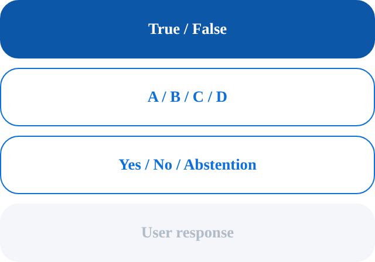

# BBBSegmentedControl

The `BBBSegmentedControl` component renders a group of buttons where exactly one option is selected at a time, such as switching between a timer and a stopwatch, or picking a poll's response type. Each option is a [`BBButton`](../Button/README.md), and the selected one is rendered with `pressed`. The options are laid out by [`BBBButtonGroup`](../ButtonGroup/README.md).



It's a controlled component: pass the selected `value` and update it from `onChange`.

## Usage Examples

### Side by side

```jsx
import { BBBSegmentedControl } from 'bbb-ui-components-react';

const [mode, setMode] = useState('timer');

<BBBSegmentedControl
  ariaLabel="Timer mode"
  options={[
    { value: 'timer', label: 'Timer' },
    { value: 'stopwatch', label: 'Stopwatch' },
  ]}
  value={mode}
  onChange={setMode}
/>
```

### Stacked, with nothing selected yet

```jsx
import { BBBSegmentedControl } from 'bbb-ui-components-react';

const [responseType, setResponseType] = useState(null);

<BBBSegmentedControl
  ariaLabel="Response type"
  stack="always"
  options={[
    { value: 'tf', label: 'True / False' },
    { value: 'a4', label: 'A / B / C / D' },
    { value: 'yna', label: 'Yes / No / Abstention' },
  ]}
  value={responseType}
  onChange={setResponseType}
/>
```

## Accessibility

The group renders `role="group"` and each option renders `aria-pressed`, so screen readers announce which option is pressed. Give the group a name with `ariaLabel` or `ariaLabelledBy`. Each option is a separate tab stop.

Use it to pick a value or a mode. To switch between views without changing any data, use tabs instead.

## Props

| Property         | Type                                                                                     | Default        | Description |
| ---------------- | ---------------------------------------------------------------------------------------- | -------------- | ----------- |
| `options`        | `{ value: string; label: string; iconStart?: ReactNode; disabled?: boolean; dataTest?: string }[]` |                | Options rendered as buttons, in order. `value` must be unique within `options`. |
| `value`          | `string \| null`                                                                         | `null`         | Value of the selected option; `null` or a value missing from `options` leaves every option unselected. |
| `onChange`       | `(value: string) => void`                                                                |                | Called with the picked option's value; not called when the already selected option is clicked. |
| `ariaLabel`      | `string`                                                                                 |                | Accessible name for the group; provide this or `ariaLabelledBy`. |
| `ariaLabelledBy` | `string`                                                                                 |                | Id of the element that labels the group; provide this or `ariaLabel`. |
| `stack`          | `'never' \| 'always' \| 'width' \| 'overflow'`                                         | `'never'`      | When the options leave their single row of equal-width buttons for a stack of full-width ones; see [`BBBButtonGroup`](../ButtonGroup/README.md)'s `stack`. |
| `stackBelow`     | `string`                                                                                 | `'20.75rem'`   | Group width, as a CSS length, below which `stack="width"` stacks the options. |
| `disabled`       | `boolean`                                                                                | `false`        | Disables every option; the selected one keeps a faded pressed fill, so the current choice stays visible. |
| `size`           | `'md' \| 'sm'`                                                                           | `'md'`         | Size of the option buttons. |
| `variant`        | `'primary' \| 'secondary' \| 'tertiary' \| 'subtle'`                                     | `'secondary'`  | Button variant of the unselected options; the selected one shows BBButton's pressed fill. |
| `id`             | `string`                                                                                 |                | HTML `id` for the group element. |
| `dataTest`       | `string`                                                                                 |                | Value for the group's `data-test` attribute. |
| `className`      | `string`                                                                                 |                | Class name forwarded to the group element, so `styled(BBBSegmentedControl)` works. |
